

  <a href="https://mattiagiordano27.github.io/sorte/">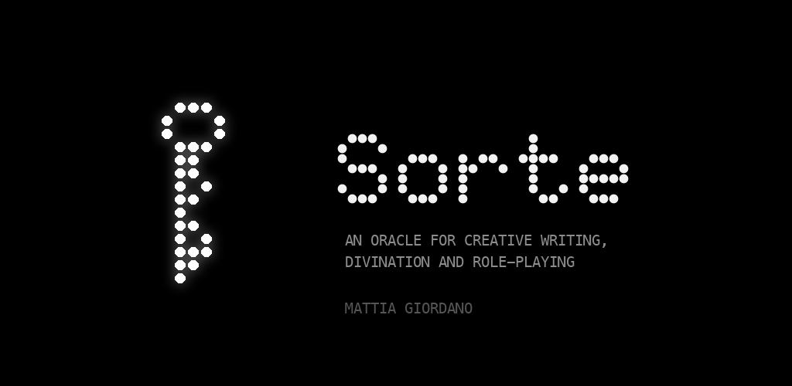</a>

<h3 align="center">An oracle for creative writing, divination and role-playing.</h3>

Three tools, one small light on your phone.

  
  
  

  
  
  
  
  
  

 

<table>
  <tr>
    <td width="33%" align="center">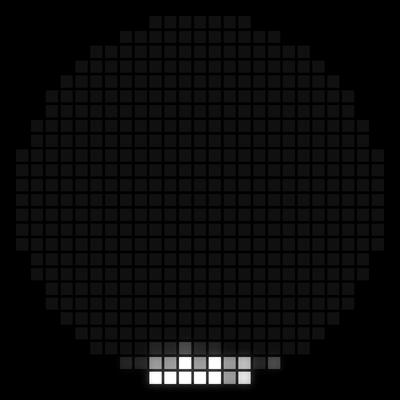</td>
    <td width="33%" align="center">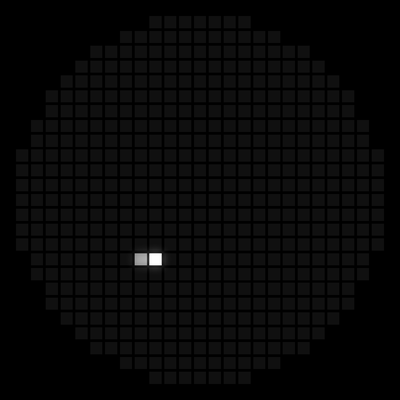</td>
    <td width="33%" align="center">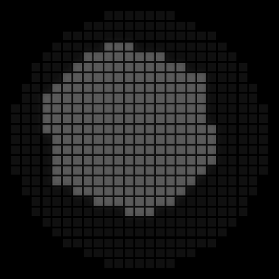</td>
  </tr>
  <tr>
    <td valign="top">GLYPH TOY · 01 <b>Closed Oracle</b> For questions you can answer with a yes or a no. A small cloud falls onto hot stones, turns to rain, then to steam, and rises again leaving the answer. The cloud runs backwards through the cycle that made it, and rises again, over and over.</td>
    <td valign="top">GLYPH TOY · 02 <b>Open Oracle</b> For open questions, the ones a yes or no can't answer: who, what, how. A little flame catches the paper; what the fire leaves behind is a symbol to read.</td>
    <td valign="top">GLYPH TOY · 03 <b>Dice</b> From d4 to d100, drawn as silhouettes. Turn the phone over and shake it like a dice cup; while charging, lift one edge and set it back down.</td>
  </tr>
</table>

 

## Features · Version 0.27

### Glyph Toys
- 🌫️ **Closed Oracle.** For questions you can answer with a yes or a no: a small cloud falls onto hot stones, turns to rain, then to steam, and rises again with the answer.
- 🔥 **Open Oracle.** A little flame burns the paper, and what the fire leaves behind is a symbol to read.
- 🎲 **Dice.** From d4 to d100, drawn as silhouettes that tumble and settle on felt.

### Oracle Deck
- 🃏 Twelve symbols from Mattia Giordano's personal oracle deck, drawn in dots.

### Interactions
- 🔘 Long press the Glyph Button to ask, or shake the phone face down.
- 🔌 While charging, lift one edge of the phone slightly and set it back down: the die falls.
- ⏳ The “but” arrives after a breath, so you never know straight away whether an answer is clean.

### Widgets
- ⚪ Three round widgets for your home screen. Tap to ask; tap the edges of the dice widget to change die.

### Everywhere
- 📱 A regular app on any Android 10+, in English and Italian.
- 🌐 A web version for iPhone, iPad and any computer. Add it to your home screen and it works offline.
- ✨ Always-on Glyph Toys for Phone (4a) Pro, used by shaking.

<b>Italiano</b>

### Funzioni · Versione 0.27

#### Glyph Toy
- 🌫️ **Oracolo chiuso.** Per le domande a cui si risponde sì o no: una piccola nuvola cade sulle pietre calde, si fa pioggia, poi vapore, e risale con la risposta.
- 🔥 **Oracolo aperto.** Una fiammella brucia la carta, e quello che il fuoco lascia è un simbolo da leggere.
- 🎲 **Dadi.** Dal d4 al d100, disegnati come sagome che rotolano e si posano sul feltro.

#### Il mazzo
- 🃏 Dodici simboli dal mazzo oracolare personale di Mattia Giordano, disegnati a puntini.

#### Interazioni
- 🔘 Pressione lunga sul Glyph Button per chiedere, oppure scuoti il telefono a faccia in giù.
- 🔌 In carica, solleva leggermente un lato del telefono e riappoggialo: il dado cade.
- ⏳ Il «ma» arriva dopo un respiro: non sai subito se la risposta è netta.

#### Widget
- ⚪ Tre widget tondi per la schermata Home. Tocca e chiedi; nel widget dei dadi tocca i bordi per cambiare dado.

#### Ovunque
- 📱 App per ogni Android 10+, in italiano e in inglese.
- 🌐 Una versione web per iPhone, iPad e qualsiasi computer. Aggiungila alla schermata Home e funziona anche offline.
- ✨ Glyph Toy always-on per Phone (4a) Pro, che si usano scuotendo.

 

## The deck

The symbols come from the drawings of Mattia Giordano and from his personal oracle deck, which exists as a physical object. He draws in dots: images that vanish from afar and only reveal themselves up close. On the matrix, a drawn dot becomes a point of light.

<table>
  <tr>
    <td align="center">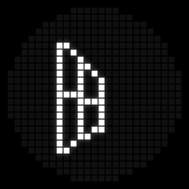 the window</td>
    <td align="center"> the star</td>
    <td align="center"> the palm</td>
    <td align="center">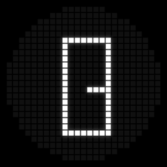 the door</td>
    <td align="center">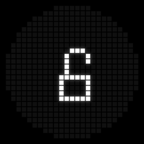 the padlock</td>
    <td align="center"> the fence</td>
  </tr>
  <tr>
    <td align="center"> the box</td>
    <td align="center"> the clouds</td>
    <td align="center">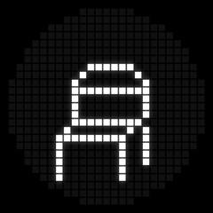 the chair</td>
    <td align="center"> the glass</td>
    <td align="center"> the power socket</td>
    <td align="center">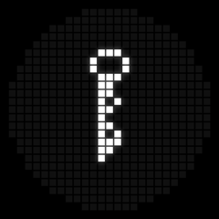 the key</td>
  </tr>
</table>

 

## The app

  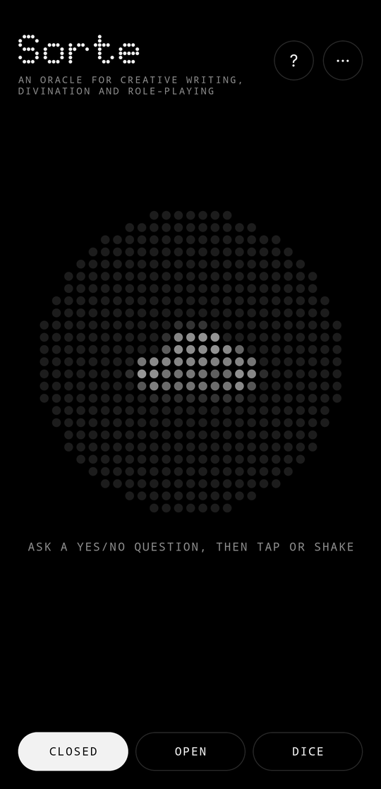&nbsp;
  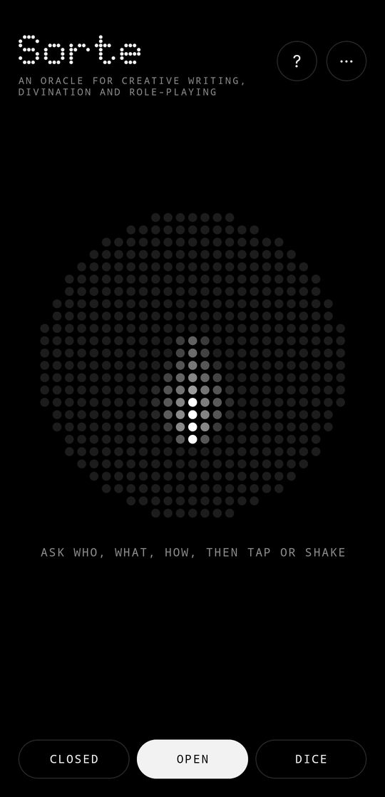&nbsp;
  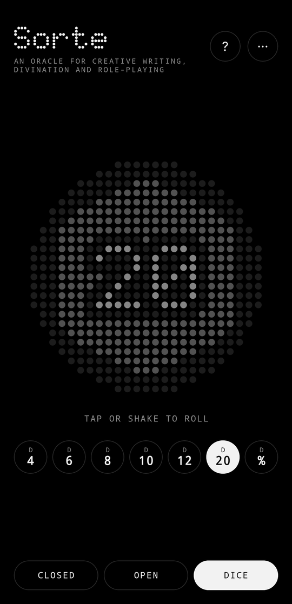

The same three tools on screen: tap the matrix or give the phone a shake. A short manual inside explains how to play, with examples, for solo role-playing, creative writing and questions of the day.

| Closed Oracle | |
|---|---|
| **NO** | No, plain and simple. |
| **NO, BUT…** | No, but something softens the blow. |
| **MEH** | The question was wrong, or there's a twist: the fire leaves a symbol. |
| **YES, BUT…** | Yes, but at a price. |
| **YES** | Yes, plain and simple. |

 

## Install

1. Download **Sorte-0.27.apk** from [Releases](https://github.com/mattiagiordano27/sorte/releases/latest) and open it on your phone (allow installing from this source when asked).
2. **Nothing Phone (3):** open Sorte › ··· › *Add to Glyph Toys*, then pick the toys with a short press on the Glyph Button.
3. **Phone (4a) Pro:** Settings › Glyph Interface › Flip to Glyph › Always-on Glyph Toy.
4. **Any other Android 10+:** use the app and the three home-screen widgets.
5. **Any other device (iPhone, iPad, Mac, Windows, Linux):** open [the web version](https://mattiagiordano27.github.io/sorte/app/) and add it to your home screen; it works offline too.

 

## Build

1. Download `glyph-matrix-sdk-*.aar` from Nothing's
   [GlyphMatrix Developer Kit](https://github.com/Nothing-Developer-Programme/GlyphMatrix-Developer-Kit)
   and put it in `app/libs/` (Nothing's licence doesn't allow redistributing it here).
2. `./gradlew :app:assembleDebug`

Development tools: `tools/editor.py` (icon editor for the 25×25 matrix), `tools/laboratorio.py` (animation and sound lab), `tools/suoni.py` (app sounds), `tools/anteprime.py` (previews).

## Credits and licences

- Concept, symbols, drawings, texts and sounds: © 2026 [Mattia Giordano](https://www.instagram.com/mattiogiordana/).
- Code: MIT licence (see `LICENSE`).
- Symbols (`app/src/main/assets/icone/`), texts and sounds: [CC BY-NC-ND 4.0](https://creativecommons.org/licenses/by-nc-nd/4.0/). Share with credit; no modifications, no commercial use.
- Font Doto, SIL Open Font License 1.1 (`app/src/main/assets/licenze/OFL-Doto.txt`).
- Glyph Matrix SDK © Nothing Technology Ltd. Independent app, not affiliated with Nothing.

  Sorte 0.27 · Mattia Giordano

